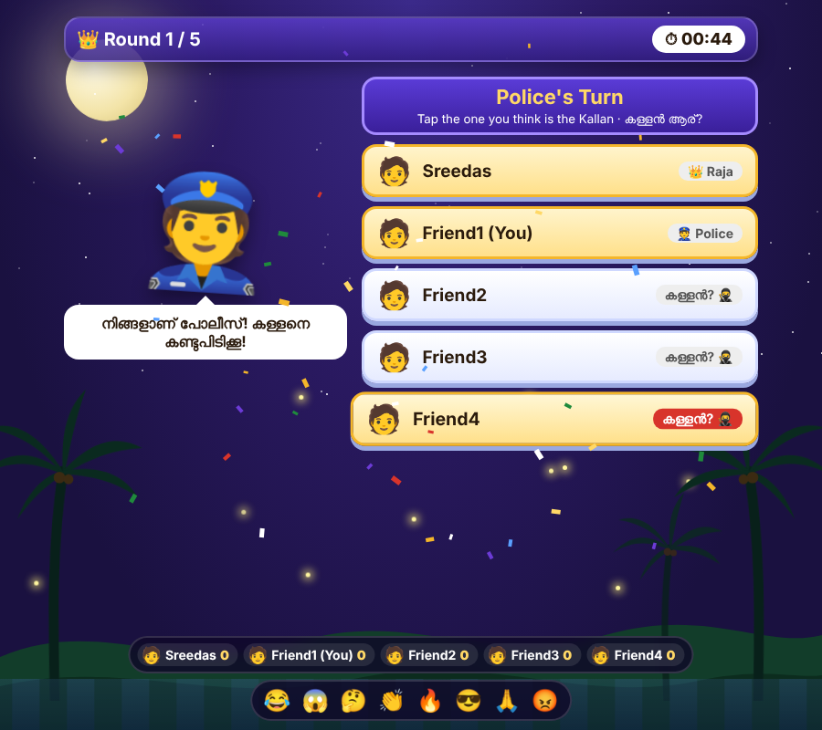

# കള്ളനും പോലീസും · Kallanum Policum



Multiplayer Malayalam chit game for 5 friends. Kerala night theme, animated cards, confetti, sound, emoji reactions.

## Rules
| Role | Points |
|---|---|
| 👑 Raja · രാജാവ് | 1000 |
| 👸 Rani · റാണി | 800 |
| 🧙 Manthri · മന്ത്രി | 700 |
| 👮 Police · പോലീസ് | 500 (only if correct) |
| 🥷 Kallan · കള്ളൻ | 0 (500 if Police is wrong) |

Flow: create room → share code → 5th player joins → server shuffles chits → each player taps to reveal (private) → all press **Got it** → host starts → Raja calls Police → Police has 45 s to pick the Kallan → points → next round → final podium.

## Security
Roles are shuffled on the server with `crypto.randomInt`. Each player's role is sent only to that player's socket. Room state sent to everyone hides roles until the game reveals them (Raja, then Police, then all after the guess).

## Run locally
```bash
npm install
npm start
# open http://localhost:3000
```
Friends on same Wi-Fi: open `http://<your-PC-IP>:3000`.

## Put online free (Render.com)
Needs a server that keeps WebSockets open — Netlify / GitHub Pages will NOT work.
1. Push this folder to a GitHub repo (e.g. `GhostCodeHunter/kallanum-policum`).
2. render.com → New → **Web Service** → pick the repo.
3. Build command: `npm install` · Start command: `npm start` · Plan: Free.
4. Share the `https://….onrender.com` link. Invite links look like `/?room=AB123`.

Railway, Fly.io or Glitch also work the same way.

Note: free Render sleeps when idle — first open takes ~30 s.
